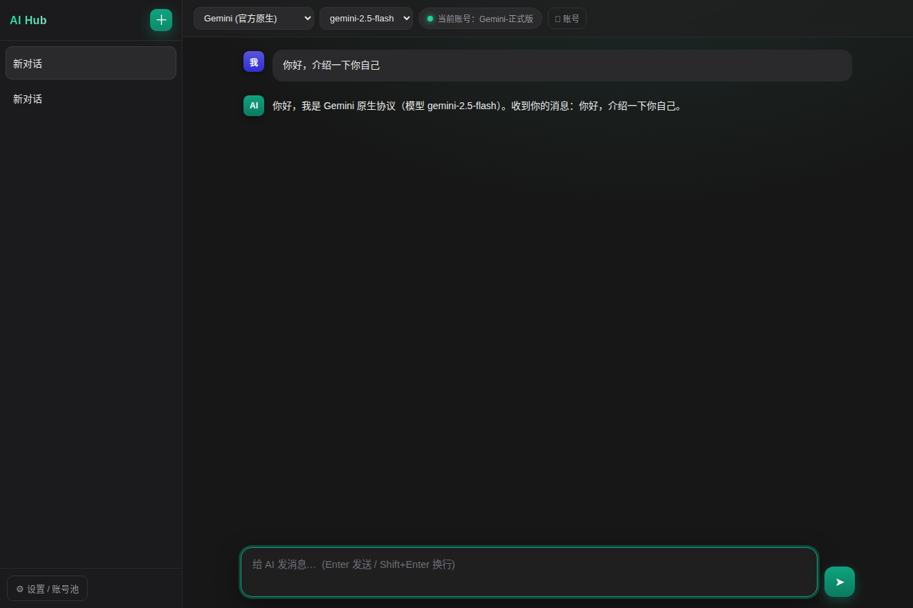
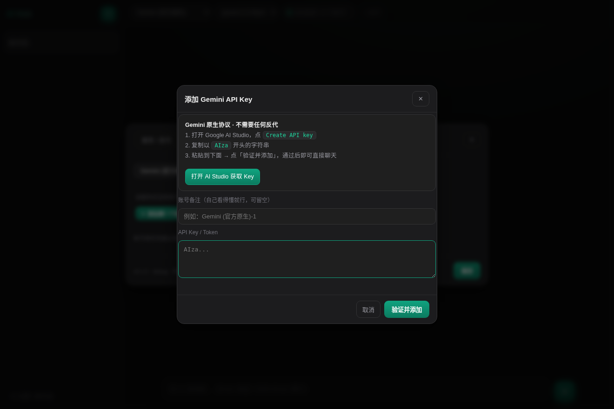
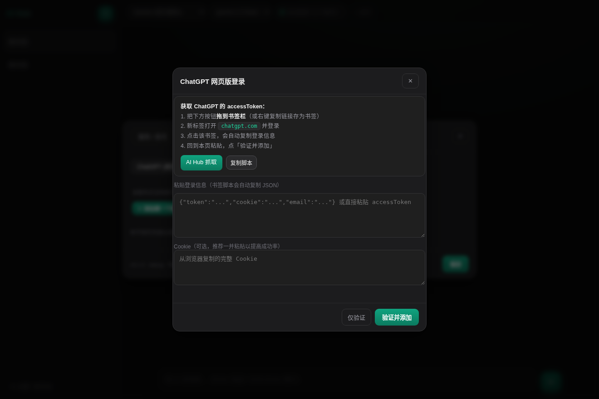

# AI Hub Web · 浏览器版

`ai-hub` 的**无 WebView2 变体**：同一个界面、同一套 Rust 后端，但改为 **本地 HTTP 服务 + 系统默认浏览器** 打开。
适合不想安装 WebView2 运行时、或希望用自己主力浏览器使用的场景。

> 界面与功能和 Tauri 版完全一致（账号池、自动故障转移、流式、Markdown 渲染、会话历史），
> 只是"窗口"从内置 WebView 换成了你的默认浏览器。



| 添加 API Key | 账号池 |
|---|---|
|  |  |

---

## 三分钟上手

1. 双击 `ai-hub-web.exe` → 自动弹出浏览器（地址形如 `127.0.0.1:4xxxx`，**命令行窗口别关**）
2. 点**左下角**「⚙ 设置 / 账号池」
3. 切到「账号池」→ 选服务 → 点「＋ 添加 API Key」→ 粘贴 Key → 「验证并添加」
4. 关掉设置 → 顶部选服务与模型 → 底部输入框打字，Enter 发送

> 找不到入口？填 API 地址在「服务 / 反代」标签，填 Key 在「账号池」标签。
> 详细步骤见下文「添加 API Key」与「抓取网页版登录态」两节，开发向细节见 [HANDOVER.md](HANDOVER.md)。

---

## 这是什么 / 不是什么

> **这是一个「可配置端点的开源客户端」**：你在设置里填入自己的反代地址、官方 API Key，
> 或用自己的账号走网页登录抓取 Token，App 负责转发与多账号管理。

- ✅ 支持：你**自己**部署的反代、你**自己**的官方 API Key（Gemini / DeepSeek / OpenRouter 等）、
  你**自己**的网页账号 Token。
- ❌ 不内置、不搜集、不集成任何「共享/泄露 Key」「盗用型代理清单」。是否合规使用由你对自己配置的
  端点与服务条款负责。请在遵守各服务商 ToS 的前提下使用。

---

## 运行方式

### 方式一：直接运行 exe（Windows）

双击 `ai-hub-web.exe`：
1. 程序在 `127.0.0.1` 的**固定端口 25880** 启动本地服务（只监听本机，局域网/外网无法访问；
   端口被占用时自动回退随机端口，也可用 `--port 9000` 或环境变量 `AI_HUB_PORT` 指定）；
2. 自动用你的默认浏览器打开 `http://127.0.0.1:25880/`；
3. 关闭浏览器标签页约 1 秒后，后台服务自动退出（也可在终端里 Ctrl+C）。

数据保存在 `%APPDATA%\ai-hub\`（与 Tauri 版共用同一份配置，可无缝切换）。

### 方式二：从源码运行

```bash
cargo run --release
```

---

## 核心特性

- **零运行时依赖**：不需要 WebView2、不需要 Node、不需要 Python——一个 5MB 左右的 exe 就是全部。
- **同一个界面**：ChatGPT 风格暗色 UI、左侧会话列表、流式打字机、Markdown + 代码高亮。
- **账号池 + 自动故障转移**：每个服务可挂多个账号；遇到 401/403/429/额度耗尽自动切到下一个健康账号，
  顶栏实时显示"当前账号"。
- **三种协议族**：Gemini **原生协议**、OpenAI 兼容接口（官方 API / 自建反代）、
  **网页版逆向协议**（ChatGPT / Claude），按服务类型自动选择。
- **生图 🎨**：输入框旁的 🎨 开关（或直接选名字带 image/flux/dall-e/gpt-image 的模型），
  走 `/images/generations`，结果以图片形式落在聊天流里。
- **文件上传 📎**：点 📎 或直接拖拽文件到窗口；图片按多模态发送，文本类文件内容自动内联，
  单个消息最多带 8 个附件。
- **ChatGPT 一键登录**：官方 OAuth（PKCE）授权即登录，`refresh_token` 自动续期，不用再抓包；
  也保留「书签脚本零粘贴抓取」和手动粘贴两种兜底。
- **流式可停止**：生成过程中点 ■ 立即中断。
- **本地隐私**：所有数据只存本机 `%APPDATA%\ai-hub\`；固定端口、仅监听 127.0.0.1。
- **前端可热加载**：`ai-hub-web.exe --web-dir ./web` 时从磁盘读前端，改完刷新即可，不必重新编译；
  设置页底部显示构建时间，方便核对 exe 是否为最新。

---

## 支持的接入方式（真实协议）

| 服务 | 协议 | 你需要提供 | 说明 |
|---|---|---|---|
| **Gemini** | `gemini_native`（**原生**） | 官方 API Key（`AIza…`） | 直连 `POST /v1beta/models/{model}:streamGenerateContent?alt=sse`，头 `x-goog-api-key`。**不需要任何反代**，AI Studio 免费额度即可 |
| **DeepSeek** | OpenAI 兼容 | 官方 API Key 或反代地址 | 默认 `api.deepseek.com/v1`；也可改成你自建的反代 |
| **ChatGPT** | `chatgpt_web` | `accessToken` + Cookie | 网页版登录态；后端自动完成 `sentinel/chat-requirements` + **PoW（SHA3-512）** + `backend-api/conversation` |
| **Claude** | `claude_web` | `sessionKey` Cookie | 后端自动取组织 UUID → 建会话 → `completion`，并用 `parent_message_uuid` 维持多轮 |
| **自定义** | OpenAI 兼容 | 任意 `/v1` 地址 + Key | 你自建/购买的任意 OpenAI 兼容反代 |

> Gemini 走的是**原生协议**，不是 OpenAI 兼容层：支持 `systemInstruction`、思维链（`thought` 部分自动过滤不展示）、
> `generationConfig`。若你确实想用兼容层，在「服务」页点「＋ 添加自定义端点」，Base URL 填
> `https://generativelanguage.googleapis.com/v1beta/openai`，Key 填同一个即可。

### 添加 API Key（Gemini / DeepSeek / 自定义端点）

设置 → 账号池 → 选中服务 → 点主按钮「**＋ 添加 API Key**」：

1. 弹窗里直接给出该服务的**取 Key 地址**（Gemini → Google AI Studio；DeepSeek → 开放平台），点一下就能打开；
2. 把 Key 粘贴进输入框（首尾空格/换行会自动清理）；
3. 点「**验证并添加**」——会先向服务端真实校验（Gemini 用 `/models` 探针，OpenAI 兼容用 `/models`），
   通过才入库；不通过会显示具体原因，并提供「仍然保存」强制入库（适合不支持探针的反代）。

粘贴时会自动识别 Key 归属（`AIza…` = Gemini、`sk-ant-…` = Anthropic、`sk-…` = DeepSeek/OpenAI 风格），
如果和当前选中的服务不匹配，会提示一键切换。

### 抓取网页版登录态（设置 → 账号池 → 网页登录）

**ChatGPT · 方式一：OAuth 一键登录（推荐）**

1. 账号池选 ChatGPT → 点「🌐 网页登录抓 Token」；
2. 点「🔑 打开 OpenAI 授权页」，在浏览器里正常登录你的 OpenAI 账号；
3. 授权完成后浏览器会跳到一个**显示错误的页面**（`platform.openai.com/auth/callback?...`）——
   这是正常的，把**地址栏里的完整网址**复制下来；
4. 粘贴到弹窗输入框，点「完成登录」。Token 三件套（含 refresh_token）自动入库，
   之后 access_token 临期会自动续期，无需再次登录。

**ChatGPT · 方式二：书签脚本零粘贴抓取**

1. 把弹窗里的「AI Hub 抓取」按钮**拖到书签栏**（或点「复制脚本」存为书签）；
2. 新标签打开 `chatgpt.com` 并登录；
3. 点一下书签——脚本在页面上下文里请求 `/api/auth/session` 拿到 accessToken，
   直接 POST 回本机 AI Hub（服务端已开 CORS），页面提示「已自动添加账号」，无需任何粘贴。

> 书签脚本里的回传地址按当前页面端口动态生成，因此固定端口/回退端口都能用。
> 方式三：也可以直接把 accessToken（或 `{"token":...,"cookie":...}` JSON）粘进输入框。

**Claude（sessionKey）**

1. 新标签打开 `claude.ai` 并登录；
2. `F12` → **Application** → **Cookies** → `https://claude.ai`；
3. 复制 `sessionKey` 的值，粘贴到弹窗，点「验证并添加」（程序会调 `/api/account` 校验并取组织 UUID）。

> `sessionKey` 是 **HttpOnly**，JS 读不到，只能手动复制——这是 Claude 的机制限制，不是偷懒。

### ⚠️ 关于网页版协议的实话

ChatGPT / Claude 的网页版**没有公开 API**，上表流程来自社区长期逆向验证（chat2api、web2api 等）。
这意味着：

- 官方随时可能调整接口或加强风控（Cloudflare / Turnstile / Arkose），导致**暂时失效**；
- 这类用法可能**违反服务条款**，封号风险自负；
- 追求长期稳定，请优先使用**官方 API** 或**自建反代**（Gemini / DeepSeek 默认就是官方接口）。

程序已做的兜底：PoW 纯本地求解（release 下 3 字节难度约 1 秒）、账号池自动切换、
错误原因回显到顶栏与账号列表，便于你判断是"账号失效"还是"协议变更"。

---

## 架构说明（为什么能"零前端改写"）

```
ai-hub-web.exe
 ├── axum HTTP 服务（127.0.0.1:固定端口 25880，占用回退随机）
 │    ├── /api/*           REST：配置 / 账号池 / 会话 / 聊天 / 上传 / OAuth
 │    ├── /api/events      SSE：把流式增量、账号切换、登录成功事件推给前端
 │    └── /*               rust-embed 内嵌的静态资源（index.html/app.js/style.css）
 └── 自动打开默认浏览器
```

前端原本调用 `window.__TAURI__.core.invoke(...)`（Tauri 的 IPC）。
`web/vendor/tauri-shim.js` 在浏览器里实现了同名 API：

- `invoke(cmd, args)` → 映射为 `fetch('/api/...')`；
- `event.listen(...)` → 映射为 `EventSource('/api/events')`；
- 页面关闭时 `sendBeacon('/api/quit')` 通知后端退出。

因此浏览器版与桌面版共享同一套前端代码，新增的「抓取登录 / 账号验证」也走同一个 `invoke` 通道，
无需为浏览器单独实现一套 IPC。

---

## 目录结构

```
ai-hub-web/
├── src/
│   ├── main.rs       # 入口：绑定随机端口、打开浏览器、优雅退出
│   ├── server.rs     # axum 路由：REST + SSE + 内嵌静态资源
│   ├── chat.rs       # 按 ptype 分发：Gemini 原生 / OpenAI 兼容 / 网页版协议
│   ├── gemini.rs     # Gemini 原生协议（streamGenerateContent + SSE + 模型列表）
│   ├── webchat.rs    # 网页版协议：ChatGPT(PoW) / Claude(sessionKey)
│   ├── config.rs     # 配置 / 账号池（与 Tauri 版同格式，含老配置迁移）
│   ├── history.rs    # 会话历史（JSON 文件存储，含多轮协议 meta）
│   └── providers.rs  # 各服务端点与 HTTP 客户端
├── build.rs          # 注入构建时间（/api/version 展示）
├── web/              # 前端（与 ai-hub 共用）
│   ├── index.html
│   ├── app.js
│   ├── style.css
│   └── vendor/tauri-shim.js   # 浏览器里的 __TAURI__ 兼容层
└── Cargo.toml
```

---

## 从源码交叉编译 Windows exe（在 Linux/macOS 上）

```bash
rustup target add x86_64-pc-windows-gnu
# 需要 mingw-w64：sudo apt install mingw-w64
cargo build --release --target x86_64-pc-windows-gnu
# 产物：target/x86_64-pc-windows-gnu/release/ai-hub-web.exe
```

也可以直接用 GitHub Actions（`.github/workflows/`）在 Windows runner 上原生构建。

---

## 常见问题

**Q: 端口每次都不一样，怎么收藏？**
A: 默认固定端口 **25880**（书签脚本/OAuth 回传都依赖端口稳定），被占用时才回退随机端口。
关掉标签页服务即退出，下次启动还是优先 25880。

**Q: 浏览器提示"无法访问此网站"？**
A: 确认 `ai-hub-web.exe` 还在运行（终端窗口没关）。它只监听 `127.0.0.1`，不要经代理软件转发 localhost。

**Q: 和 Tauri 版（ai-hub.exe）有什么区别？**
A: 界面、功能、数据格式完全一致。Tauri 版是独立窗口（依赖 WebView2），本版本用你的默认浏览器。
两边可以同时安装，共用 `%APPDATA%\ai-hub\` 配置。

**Q: 点了按钮没反应 / 界面和说明对不上？**
A: 先看设置页底部那行「v0.2.0 · release · 构建 2026-xx-xx xx:xx」——那是 exe 内嵌前端的构建时间。
如果和你手上的 exe 版本不符，说明前端是旧快照，重新编译即可。想改 UI 不重编译，用：

```bash
ai-hub-web.exe --web-dir ./web
```

此时前端从磁盘读，改完 `index.html` / `app.js` / `style.css` 刷新浏览器就生效（响应带 `Cache-Control: no-store`，不会吃到旧缓存）。

**Q: 为什么不用 `prompt()` 那种弹框？**
A: 浏览器可能拦截页面弹框（勾过"阻止此页面创建更多对话框"后会静默返回空），
所以添加 Key 改成了页面内表单弹窗，稳定可见。
